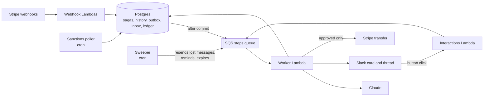
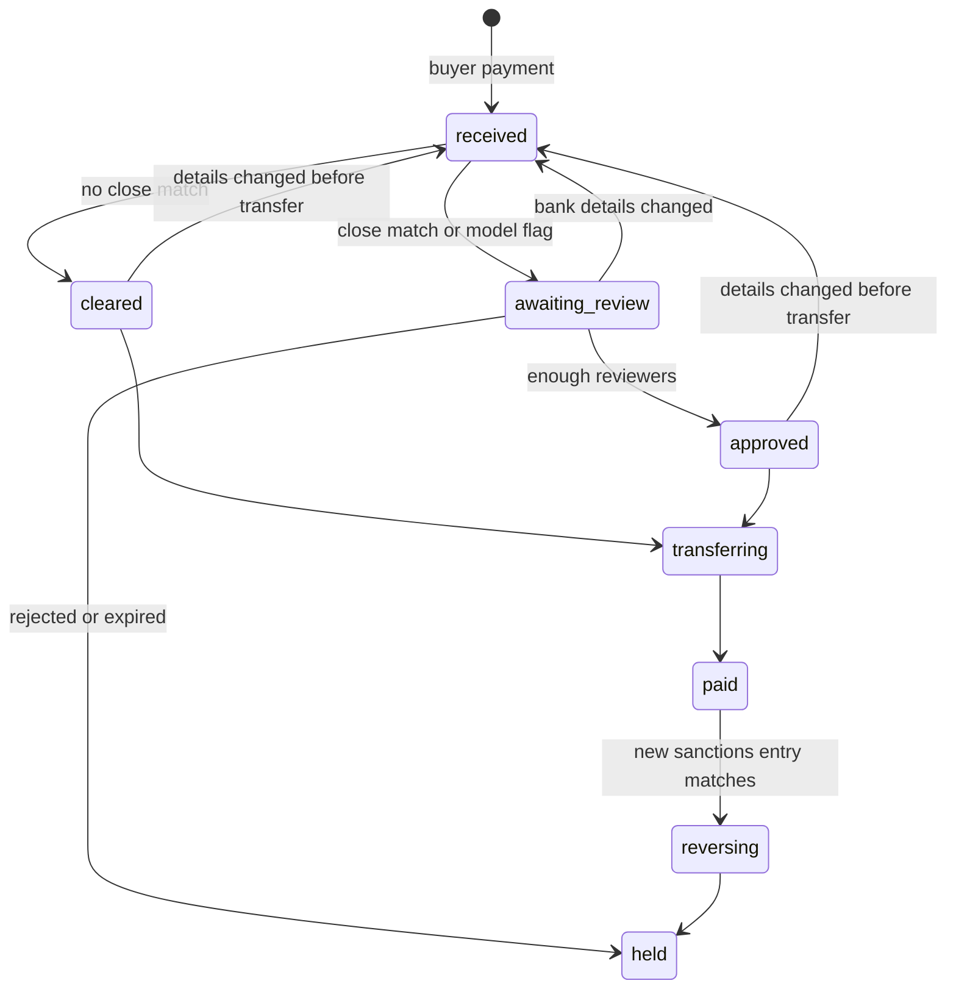

# Payout screening agent with human approval in Slack

A reference app for one question: how do you put a person inside an event-driven workflow without paying anyone twice, losing a message, or trusting a model's output blindly?

A marketplace pays out to sellers through Stripe Connect (test mode). Before money moves, the app screens each seller against the US Treasury OFAC SDN list. A Claude model weighs the close calls. A compliance reviewer approves or rejects the flagged payouts in Slack. Only an approved decision releases the transfer. The marketplace keeps a 10% commission, so a $125.00 payment pays the seller $112.50, and a double-entry ledger records every movement, including the commission.

This is a demo. It isn't legal or compliance advice, and it screens company names only. The seller names are invented. The demo screens them against the real SDN list plus 3 fictional entries, so every near miss in the demo matches a fictional entry.

## How it works



Each payout is a saga: one row in `sagas`, moved one status at a time.



`transferring` is the point of no return. Before it, any change sends the saga back to screening. After it, only a transfer reversal can undo the money.

## Patterns

| Pattern                                    | Where                                                      | Source                                                                                  |
| ------------------------------------------ | ---------------------------------------------------------- | --------------------------------------------------------------------------------------- |
| Saga with compensating steps               | `packages/core/src/saga/states.ts`, `saga/compensation.ts` | Garcia-Molina and Salem, "Sagas" (1987); Richardson, _Microservices Patterns_           |
| Transactional outbox                       | `saga/unit-of-work.ts`                                     | Richardson, _Microservices Patterns_                                                    |
| Polling publisher (the sweeper)            | `saga/sweeper.ts`                                          | Richardson, _Microservices Patterns_                                                    |
| Conditional write on status and version    | `saga/transition.ts`                                       | Kleppmann, _Designing Data-Intensive Applications_, ch. 7                               |
| Idempotent receiver                        | `worker.ts`, `saga/intake.ts`                              | Hohpe and Woolf, _Enterprise Integration Patterns_                                      |
| Content enricher                           | `screening/gleif.ts`                                       | _Enterprise Integration Patterns_                                                       |
| Poller as event producer                   | `screening/poller.ts`                                      | _Enterprise Integration Patterns_ (Polling Consumer)                                    |
| Approval bound to the exact payload        | `stripe/payments.ts` (`payloadHash`), `saga/decisions.ts`  |                                                                                         |
| Two different reviewers for a strong match | `policy.ts`, `saga/decisions.ts`                           | OFAC, "A Framework for OFAC Compliance Commitments" (2019)                              |
| Idempotency keys, plus look-before-write   | `saga/steps.ts` (`completeTransfer`)                       | Stripe API docs; Brandur Leach, "Implementing Stripe-like Idempotency Keys in Postgres" |
| Expiry means no                            | `saga/sweeper.ts`                                          | Saltzer and Schroeder (1975), fail-safe defaults                                        |
| Model output as untrusted input            | `agent/assess.ts`                                          | Anthropic API docs on structured outputs and stop reasons                               |

Regular code and model calls fail differently, so the app handles them on separate paths:

- **Regular code** (a bug, a bad config) throws. SQS retries the message 5 times, then moves it to the dead-letter queue.
- **Model I/O** returns a typed failure. An unavailable API retries up to 3 times. Other failures never retry: a `max_tokens` stop, a refusal, output that fails the schema, or a reference to an entity the model wasn't shown. Each one sends the payout to a reviewer with "The agent couldn't decide".
- **Policy is code.** The name score sets a floor the model can't lower. The model can only add caution.

## Run the tests

You need Node 22 or later. The tests use an in-process Postgres (PGlite) and fakes for Stripe, Slack, and Claude, so they need no accounts.

```sh
npm install
npm test
npm run typecheck
npm run lint
```

PGlite has one connection, so the tests can't prove a race between two Lambdas. The row lock in `saga/decisions.ts` and the conditional update in `saga/transition.ts` handle that case.

## Deploy the demo

You need an AWS account, a [Neon](https://neon.tech) Postgres database, a Stripe account in test mode with Connect, a Slack workspace, and an Anthropic API key.

Before `setup` can create sellers, Stripe requires 2 acknowledgments in **Settings > Connect > Platform profile**: the refunds and chargebacks liability acknowledgment, and the ongoing seller compliance acknowledgment. These are account settings, not test-mode settings.

If `sst` reports that AWS credentials aren't configured after `aws login`, export them into the shell first: `eval "$(aws configure export-credentials --format env)"`.

1. Set the secrets. SST stores them in AWS SSM. Leave the value off the command line so it stays out of your shell history. SST reads it from standard input, so `< file` also works.

   ```sh
   for s in DatabaseUrl AnthropicApiKey StripeSecretKey SlackSigningSecret SlackBotToken SlackChannelId; do
     npx sst secret set $s --stage demo
   done
   echo placeholder | npx sst secret set StripeWebhookSecret --stage demo
   echo placeholder | npx sst secret set StripeConnectWebhookSecret --stage demo
   ```

2. Deploy, then create the tables.

   ```sh
   npm run deploy
   npm run db:migrate
   ```

3. Create the Slack app from `slack-manifest.yaml`. Replace `REPLACE_WITH_API_URL` with the `api` output from step 2. Install the app, then set its bot token and signing secret from step 1 again.
4. Create the Stripe webhooks, seed the sanctions mirror, and create the demo sellers. Then deploy again so the functions read the webhook secrets.

   ```sh
   npm run demo -- setup
   npm run deploy
   ```

## Demo scenes

| Scene | Command                                                                                          | What happens                                                                         |
| ----- | ------------------------------------------------------------------------------------------------ | ------------------------------------------------------------------------------------ |
| 1     | `npm run demo -- pay clean`                                                                      | No close match. Cleared and paid with no model call.                                 |
| 2     | `npm run demo -- pay near`                                                                       | A near-miss name. The agent explains the match, and a reviewer approves or rejects.  |
| 3     | `npm run demo -- pay race`                                                                       | 2 reviewers click Approve at the same moment. One decision applies.                  |
| 4     | `npm run demo -- pay strong`, approve once, then `npm run demo -- bank strong`                   | The bank change voids the first approval and resets the card.                        |
| 5     | `npm run demo -- pay near`, then wait                                                            | A reminder after 2 minutes. At 5 minutes the review expires and the funds stay held. |
| 6     | `npm run demo -- pay harbor`, then `npm run demo -- list-add "Tidewick Lantern Imports Limited"` | A new sanctions entry matches a paid seller. The transfer is reversed.               |
| 7     | `stripe events resend <evt_id> --webhook-endpoint <we_id>`                                       | Stripe redelivers an event. The inbox ignores it.                                    |
| 8     | `npm run demo -- pay clean --chaos=skip_dispatch`                                                | The step commits but its message never sends. The sweeper finds it within 2 minutes. |
| 9     | `npm run demo -- pay near --chaos=llm_max_tokens`                                                | The model stops at `max_tokens`. The payout goes to a reviewer.                      |

`npm run demo -- reset` clears payouts between takes. The demo stage uses short timers and its own copy of the sanctions list. `setup` seeds that copy from Treasury and adds the fictional entries, and scene 6 adds one more.

## Cost

The queue consumer long-polls SQS, and the sweeper and poller wake the database every minute. Between recordings, run `DEMO_PAUSED=true npm run deploy` to keep the endpoints and stop the background work. Run `npx sst remove --stage demo` to delete everything.

## Known limits

- Slack has no idempotency key. A crash between posting a card and saving its timestamp can post a second card. Its buttons stay safe, because every click is checked against the saga row.
- Stripe can drop an idempotency key after 24 hours. The transfer step looks for an existing transfer to the seller with its saga ID in `metadata` before it creates one.
- In test mode, Stripe retries a failed webhook only 3 times over a few hours.
- The approval hash uses the bank account's record ID, not its fingerprint. Re-adding even the same account number voids an approval, which is the conservative choice for fraud control.
- The 10% commission also covers Stripe's processing fee. A transfer can't exceed what the charge added to the platform's available balance.
- The demo doesn't release held funds. A real system needs a second, audited path for that.
